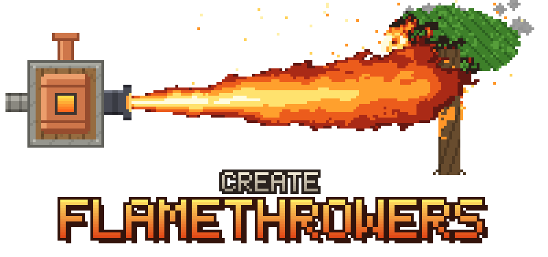
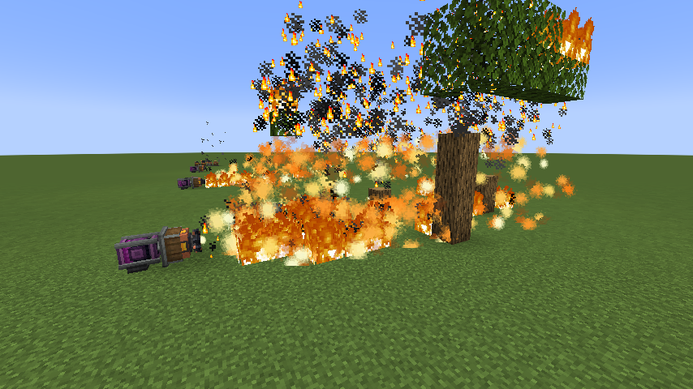
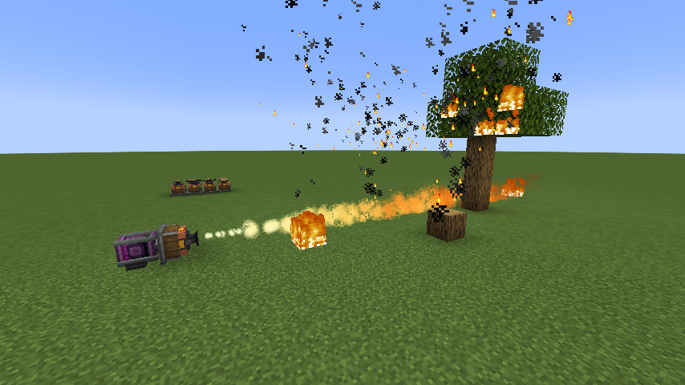
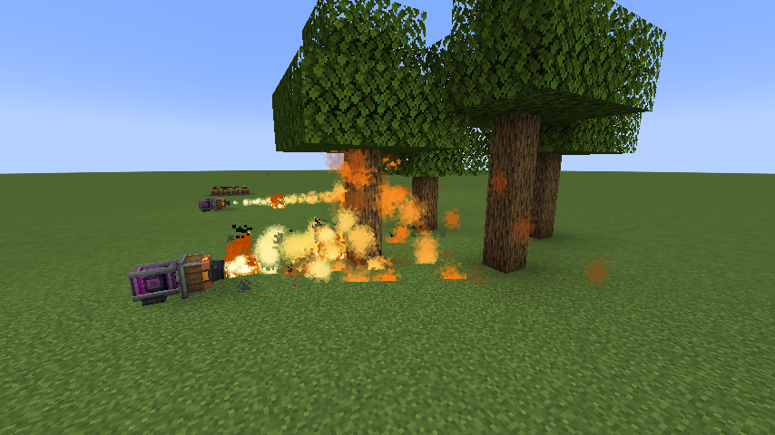
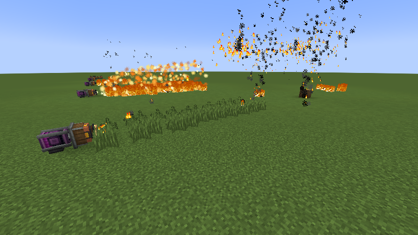
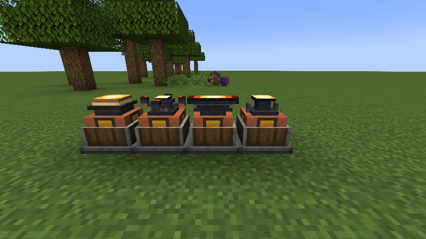

# Create: Flamethrowers

**Lava-powered flamethrowers for [Create](https://modrinth.com/mod/create) on NeoForge 1.21.1**
Built for **Create Aeronautics** vehicles and **Let it Walk!** walkers.

These flamethrowers do more than light fires: they **actively burn away wood, leaves, plants, wool, snow and ice**.
When the flame hits a trunk, the whole tree burns from the bottom up in 1–2 seconds.
A vehicle fitted with flamethrowers can burn a path through a forest in very little time.

## The four types

| | Type | Effect | Range* | Lava* | Stress |
|---|---|---|---|---|---|
|  | **Jet Flamethrower** | long, narrow jet that pierces several blocks of wood | 16 | 40 mB/s | 8 SU/RPM |
|  | **Fan Flamethrower** | wide cone (±32°) for leaves and undergrowth | 7.5 | 60 mB/s | 6 SU/RPM |
|  | **Fire Tornado Flamethrower** | spinning fire spiral, 5–8 blocks wide, that sucks in and lifts mobs | 11 | 80 mB/s | 12 SU/RPM |
|  | **Napalm Launcher** | lobs sticky napalm blobs in an arc that keep burning for 5 s where they land | ~25 | 100 mB/shot | 10 SU/RPM |

\* at 64 RPM. A faster shaft gives more range (up to x1.6) and more heat (up to x3), but also uses more lava.

## How to use

A flamethrower fires as soon as it has **rotation + lava + no redstone signal**.

1. **Place it:** the nozzle points where you are looking (sneak to point it towards you). You can turn it with a wrench.
2. **Shaft:** connect it at the back. It needs at least medium speed (Create default: 30 RPM).
3. **Lava:** connect a Create pipe to any side except the nozzle, or right-click it with a lava bucket. The tank holds 4000 mB and accepts lava only.
4. **Switching off:** a redstone signal (lever, redstone link …) or a clutch in the shaft line turns it off.

The **Engineer's Goggles** show the status (firing / no lava / too slow / overstressed / redstone), the lava amount, the range and the lava use.

### On vehicles
Create Aeronautics and Let it Walk! are both built on **Sable**. A flamethrower detects when it sits on a ship or walker and converts
its nozzle position, direction and the vehicle's speed into the real world, so the flame turns and tilts with the vehicle.
It never burns its own vehicle or the crew standing on it.

A good forest-clearing setup: a Fire Tornado in the middle at the front, two Jet Flamethrowers next to it, all on one shaft at 64 RPM or more and fed from a shared lava tank.
Put a redstone link next to them to switch them off from the driver's seat.

### How burning works
- Every block in the flame collects heat. Leaves and plants go instantly, wood takes about 0.5–1 s.
- A burning log or leaf block sets the rest of its tree on fire (a limited chain reaction, so the whole forest does not go up in flames).
- Stone, other non-flammable blocks and water stop the flame.
- Logs sometimes drop charcoal, and fire is left on the ground. Chests and barrels are never burned.
- A cap on burned blocks per tick protects the server.

## Recipes (crafting table)
| Result | Pattern | Ingredients |
|---|---|---|
| Jet | `IBI / PCP / _S_` | copper sheet, blaze rod, fluid pipe, andesite casing, shaft |
| Fan | `III / _J_` | copper sheet + Jet Flamethrower |
| Fire Tornado | `_R_ / IJI / _M_` | propeller, copper sheet, Jet Flamethrower, precision mechanism |
| Napalm | `SBS / FJF` | slime ball, brass casing, fire charge, Jet Flamethrower |

## Configuration
`create_flamethrowers-server.toml` (in the world's `serverconfig/` folder):
`burnBlocks`, `placeFire`, `treeCascade`, `cascadeDepth`, `maxBurnsPerTick`, `charcoalChance`, `heatMultiplier`,
`rangeMultiplier`, `lavaMultiplier`, `entityDamage`, `hurtCrew`, `burnBlockEntities`, and the stress impact per type.

Block tags: `create_flamethrowers:flame_proof` (never burned), `create_flamethrowers:extra_burnable`, `create_flamethrowers:tree_parts` (spread the tree fire).

## Requirements
- NeoForge 21.1 (Minecraft 1.21.1)
- Create 6.0+
- Sable 2.x (shipped with Create Aeronautics)
- optional: Create Aeronautics, Let it Walk!

Note: the in-game names are available in English and German.

## Building
1. Put the required jars into `libs/` (see [libs/README.md](libs/README.md)). Other mods are not included in this repository.
2. `./gradlew build` → `build/libs/create_flamethrowers-<version>.jar`

More tasks:
- `./gradlew runGameTestServer`: 6 automated tests (the jet burns down a tree while stone stops the flame; no lava / too slow / redstone;
  the fan clears leaves; the fire tornado sucks in a mob; napalm hits a tree 20 blocks away; a flamethrower on a real Sable ship).
  Create and Sable must be in `run/mods/` for this.
- `./gradlew runShowcase`: visual check. Loads `run/saves/showcase` (for example a copy of `run/world` after a test run), builds every type in front of trees, takes screenshots and quits.
- `python tools/gen_assets.py`: regenerates the block models, blockstates, textures and flame particles.
- `python tools/gen_logo.py`: regenerates the logo (`docs/logo.png` and the mod list logo `src/main/resources/logo.png`).
